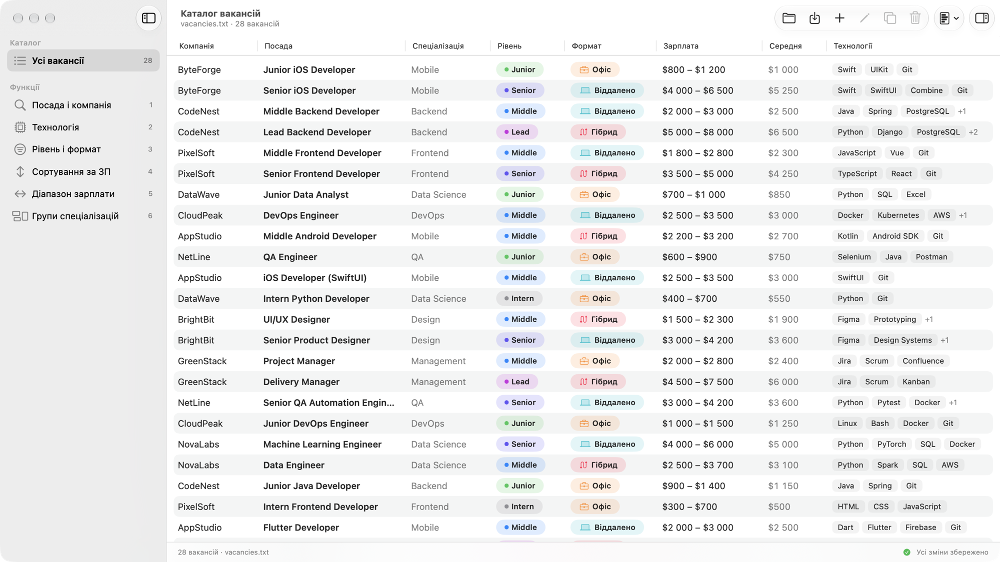

# Каталог вакансій для ІТ-спеціалістів

Курсова робота з дисципліни «Об'єктно-орієнтоване програмування», варіант 13.
Віконний застосунок для macOS на Swift і SwiftUI.

- **Виконав:** Власюк Артур Володимирович, група ПЗ-24
- **Керівник:** доцент кафедри ПЗ, к.т.н., доцент Коротєєва Т. О.
- **Приймає роботу:** асистент кафедри ПЗ Паламарчук Дмитро Юрійович
- **Заклад:** Національний університет «Львівська політехніка», кафедра програмного забезпечення, 2026

> Статус: програму написано й протестовано (етапи 4–5). Пояснювальна записка — у роботі.



## Зміст

1. [Можливості](#можливості)
2. [Що з ООП реалізовано](#що-з-ооп-реалізовано)
3. [Системні вимоги](#системні-вимоги)
4. [Як зібрати й запустити](#як-зібрати-й-запустити)
5. [Формат файлу даних](#формат-файлу-даних)
6. [Структура проєкту](#структура-проєкту)
7. [Тести](#тести)
8. [Документація](#документація)

## Можливості

**Функції варіанта 13** — у бічній панелі, у меню «Аналіз» і клавішами ⌘1…⌘6:

| № | Функція | Як працює |
|---|---|---|
| 1 | Пошук за назвою посади та компанією | обидві умови разом, «містить», без урахування регістру; порожнє поле — будь-яке значення |
| 2 | Пошук за технологією | точний збіг назви без урахування регістру («Swift» не знаходить «SwiftUI»); поле підказує технології каталогу |
| 3 | Рівень досвіду та формат роботи | обидва значення вибираються зі списків |
| 4 | Сортування за середньою зарплатою | власне **сортування злиттям**, за спаданням або зростанням; стабільне (рівні середні — у порядку файлу) |
| 5 | Найменший і найбільший діапазон зарплати | показує **всі** вакансії з крайніми значеннями, зокрема однаковими |
| 6 | Групування за спеціалізацією | групи за абеткою, у групі — від більшої максимальної зарплати до меншої (тим самим сортуванням злиттям) |

**Вакансії:** додати, редагувати й дублювати у формі з перевіркою полів (помилка з'являється під полем),
вибрати кілька рядків (⌘-клік) і видалити разом, переглянути всі дані в панелі деталей.

**Файли:** відкрити, зберегти, «Зберегти як…»; рядок стану показує «Є незбережені зміни», а перед відкриттям іншого
файлу програма питає, чи зберегти зміни. Якщо у файлі помилка, повідомлення називає номер рядка й причину,
а каталог лишається без змін. «Демо-дані» в порожньому вікні відкривають вбудований каталог із 28 вакансій.

**Інтерфейс:** меню з гарячими клавішами, контекстне меню рядка, підказки до кнопок, вікно довідки (⌘?), світла й
темна теми, підписи для VoiceOver.

| Меню | Команди |
|---|---|
| Файл | Новий каталог ⇧⌘N · Відкрити… ⌘O · Зберегти ⌘S · Зберегти як… ⇧⌘S |
| Вакансія | Додати вакансію… ⌘N · Редагувати… ⌘E · Дублювати ⌘D · Видалити ⌘⌫ |
| Аналіз | Усі вакансії ⌘0 · функції 1–6 ⌘1…⌘6 · Виконати функцію ⌘⏎ |
| Довідка | Довідка «Каталог вакансій» ⌘? |

## Що з ООП реалізовано

| Вимога | Де в коді |
|---|---|
| Клас з інкапсуляцією | `Vacancy` — 8 полів, перевірка `validate()`; `VacancyCatalog` — `private(set) var vacancies`, змінюється лише методами |
| Конструктори і деструктор | `Vacancy`: за замовчуванням, з параметрами, **конструктор копій** `init(copyOf:)`, `deinit` |
| Успадкування і поліморфізм | базовий клас `CatalogOperation` і 6 підкласів (функції 1–6) з перевизначеним `execute(on:)`; програма викликає всі через один тип |
| Перевантаження операторів | читання з файлу `reader >> vacancy`, запис у файл `writer << vacancy` (`Storage/`) |
| Винятки | `enum VacancyError: Error` (15 випадків); кидають читач файлу, `validate()` і функції 1–6, ловить `CatalogViewModel` (`do-catch`) |
| Узагальнений клас | `MergeSorter<Element>` — сортування злиттям для будь-якого типу |
| Переліки | `ExperienceLevel`, `WorkFormat` — значення для файлу й інтерфейсу |

Чому класи влаштовано саме так (з аналогами в C++) — у [`docs/analysis/05-classes.md`](docs/analysis/05-classes.md);
діаграми класів — у [`docs/uml/`](docs/uml).

## Системні вимоги

- **Запуск:** macOS 26 або новіша.
- **Збирання:** Xcode 27 (перевірено на Xcode 27.2). Обліковий запис розробника не потрібен: збірка підписується для
  локального запуску (Sign to Run Locally).

## Як зібрати й запустити

**У Xcode:** відкрити `app/VacancyCatalog.xcodeproj`, вибрати схему **VacancyCatalog** і натиснути ⌘R.

**У терміналі** (з кореня репозиторію):

```bash
xcodebuild -project app/VacancyCatalog.xcodeproj -scheme VacancyCatalog -configuration Release -destination 'platform=macOS' -derivedDataPath build build
```

```bash
open build/Build/Products/Release/VacancyCatalog.app
```

Після запуску натисніть «Демо-дані» або відкрийте файл із [`samples/`](samples) (Файл → Відкрити…, ⌘O).
Файли з `samples/` — демо-дані й еталон для автотестів, тож експерименти зі збереженням краще робити на копії.

## Формат файлу даних

Текстовий файл у кодуванні UTF-8, **одна вакансія — один рядок**, 8 полів через `;`, технології — через `,`.
Порожні рядки й рядки, що починаються з `#`, пропускаються.

```text
# Каталог вакансій для ІТ-спеціалістів
# компанія;посада;спеціалізація;рівень;мін;макс;формат;технології
ByteForge;Junior iOS Developer;Mobile;Junior;800;1200;Office;Swift,UIKit,Git
CodeNest;Lead Backend Developer;Backend;Lead;5000;8000;Hybrid;Python,Django,PostgreSQL,Docker,AWS
```

| № | Поле | Правило |
|---|---|---|
| 1 | компанія | 1–60 символів, без `;` |
| 2 | посада | 1–80 символів, без `;` |
| 3 | спеціалізація | 1–40 символів, без `;` |
| 4 | рівень досвіду | `Intern`, `Junior`, `Middle`, `Senior` або `Lead` |
| 5 | мінімальна зарплата, $ | ціле число 0…100 000, не більше за максимальну |
| 6 | максимальна зарплата, $ | ціле число 0…100 000 |
| 7 | формат роботи | `Office`, `Remote` або `Hybrid` |
| 8 | технології | 1–15 назв через `,`, кожна 1–30 символів; повтори (без урахування регістру) прибираються |

Повний опис моделі — [`docs/analysis/02-data-model.md`](docs/analysis/02-data-model.md).
Приклади файлів з помилками для демонстрації винятків — `samples/broken-*.txt`.

## Структура проєкту

```text
kursova-1/
├── app/
│   ├── VacancyCatalog.xcodeproj
│   ├── VacancyCatalog/
│   │   ├── App/            точка входу, меню й гарячі клавіші
│   │   ├── Model/          Vacancy, ExperienceLevel, WorkFormat, VacancyError, VacancyGroup, SalaryRangeExtremes
│   │   ├── Storage/        VacancyFileReader (>>), VacancyFileWriter (<<)
│   │   ├── Logic/          VacancyCatalog, MergeSorter, OperationResult, TextFormat
│   │   │   └── Operations/ CatalogOperation і 6 функцій варіанта
│   │   ├── ViewModel/      CatalogViewModel — стан вікна
│   │   ├── Views/          вікна й панелі SwiftUI
│   │   ├── DesignSystem/   кольори, відступи, бейджі, чипи (як компоненти в Figma)
│   │   └── Resources/      іконка, локалізовані назви, вбудовані демо-дані
│   └── VacancyCatalogTests/ автотести Swift Testing
├── samples/                vacancies.txt (28 вакансій), broken-*.txt, empty.txt
└── docs/
    ├── PLAN.md             план курсової
    ├── analysis/           функції 1–6, модель даних, тестові дані, прецеденти, класи
    ├── design/             знімки макета з Figma, іконка, вітрина дизайн-системи в коді
    ├── uml/                діаграми прецедентів, класів, послідовності й діяльності (PlantUML + PNG)
    ├── testing/            автотести й покриття, ручний протокол, винятки
    └── report/figures/     знімки програми для пояснювальної записки
```

Один тип (клас, структура, перелік) — один файл з такою самою назвою.

## Тести

```bash
xcodebuild -project app/VacancyCatalog.xcodeproj -scheme VacancyCatalog -destination 'platform=macOS' test
```

150 автотестів у 20 наборах (Swift Testing). Покриття ядра програми (модель, файли, логіка, стан вікна) — 98,2 %.

- Набори тестів і покриття — [`docs/testing/01-unit-tests.md`](docs/testing/01-unit-tests.md)
- Ручний протокол M-01…M-18 зі знімками і знайдені дефекти — [`docs/testing/02-manual-protocol.md`](docs/testing/02-manual-protocol.md)
- Демонстрація винятків E-1…E-7 — [`docs/testing/03-exceptions.md`](docs/testing/03-exceptions.md)

## Документація

- **Дизайн у Figma:** [макет](https://www.figma.com/design/YDr0praKAGRczdbVic7XzA) ·
  [клікабельний прототип](https://www.figma.com/proto/YDr0praKAGRczdbVic7XzA?node-id=83-2&starting-point-node-id=83%3A2) ·
  знімки — [`docs/design/`](docs/design)
- **UML:** [`docs/uml/uml-documentation.md`](docs/uml/uml-documentation.md) — опис усіх діаграм
- **Аналіз:** [`docs/analysis/`](docs/analysis) — як розуміємо функції 1–6, модель даних, тестові дані
- **План роботи:** [`docs/PLAN.md`](docs/PLAN.md)
- **Пояснювальна записка:** буде в `docs/report/` (етап 7)
